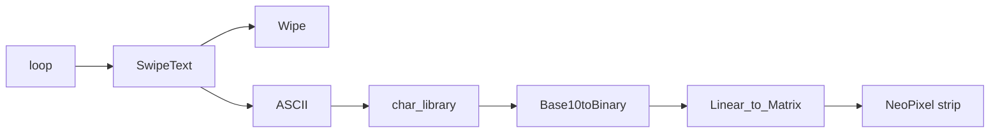
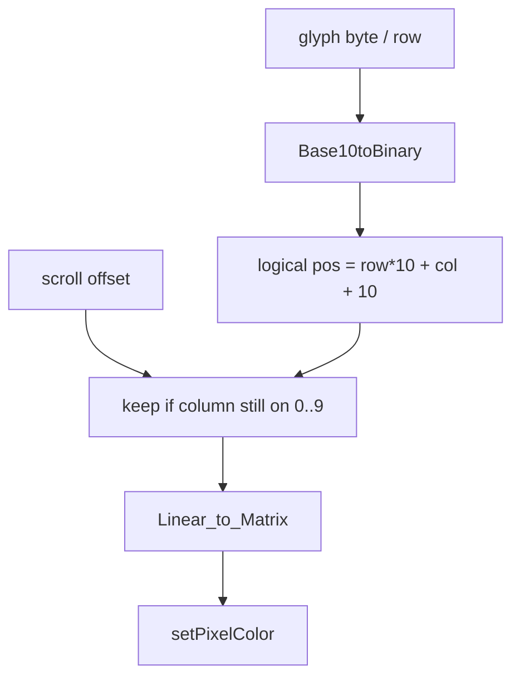

# Text_Display

Arduino NeoPixel matrix that scrolls text. 10x10 (100 LEDs) on pin 6, using Adafruit_NeoPixel. Right now it just loops `Made by Andrew Friedman.`

The strip is wired in a snake, so `Linear_to_Matrix` remaps x/y before anything actually gets lit.



`StringToASCII` is in here too (one character at a time) but nothing calls it.

## How the mapping works

Everything assumes a square grid: `sqrt(NUMPIXELS)` is 10. Fonts are 8x8, so they get padded into that 10x10.

`char_library[96][8]` is ASCII 32–127. Each glyph is 8 bytes, one per row, high bit on the left. `ASCII()` looks up `(int)c - 32`.

`Base10toBinary` turns a row byte into a `'0'`/`'1'` string and pads it out to the matrix width. Once the string hits length 8 it also appends an extra `0` while padding, so a lot of rows come out 11 bits instead of 10. That leftover bit spills into the next column math. There's a TODO to make this an int array instead of a `String`.

`ASCII()` then walks those bits into a logical index:

```
pos = row * 10 + col + ceil((10 - 8) / 2) * 10
```

The `ceil((10-8)/2)*10` term shoves the 8-row glyph down by one row so it sits closer to the middle of the 10. `col` is just the bit index in that binary string.

Scrolling is the same coordinates plus an `offset`. A pixel only gets stored if `(pos % 10) + offset` is still in `0..9`, so characters clip at the left/right edges instead of wrapping. `SwipeText` runs `offset` from `-9` to `8 * strlen`, and each frame only draws the characters whose 8-wide windows overlap the matrix (`i` from `(a-1)/8` to `(a+16)/8`). Delay is 150ms per frame. Green is hardcoded `Color(0, 150, 0)`.

Those logical indexes are *not* NeoPixel indexes. The strip is snaked, so `Linear_to_Matrix` remaps before `setPixelColor`.

Logical layout is row-major: `input = y * 10 + x`. After the even/odd column flip, a y-invert, and a final x-mirror, the physical index is:

```
physical = (9 - x) * 10 + (x is even ? y : 9 - y)
```

Even logical columns run one way along the strip, odd columns run back the other way, and LED `0` lands on logical `(9, 9)` — opposite corner from `(0, 0)`.



A couple of sharp edges that match the TODOs: `if (i != 0)` skips lighting logical pixel 0, `Coordinates` is zero-initialized so that check is also how empty slots get ignored, and none of this works for a non-square panel.

TODO:
- Support other font libraries
- Support non square dimensions
- Make it possible to display all lights
- Consistent var names
- Optimize

Written around July 2019 (`Text_Display.ino`).
