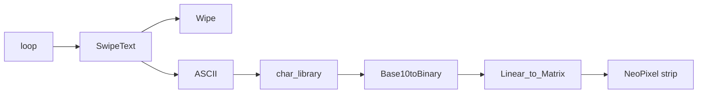

# Text_Display

Arduino NeoPixel matrix that scrolls text. 10x10 (100 LEDs) on pin 6, using Adafruit_NeoPixel. Right now it just loops `Made by Andrew Friedman.`

The strip is wired in a snake, so `Linear_to_Matrix` remaps x/y before anything actually gets lit.

`StringToASCII` is in here too (one character at a time) but nothing calls it.

TODO:
- Support other font libraries
- Support non square dimensions
- Make it possible to display all lights
- Consistent var names
- Optimize

Written around July 2019 (`Text_Display.ino`).
